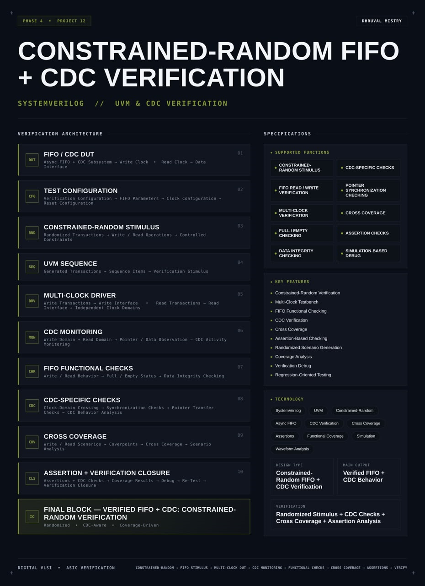
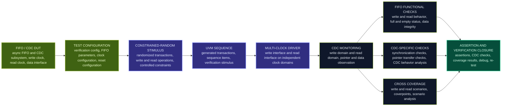
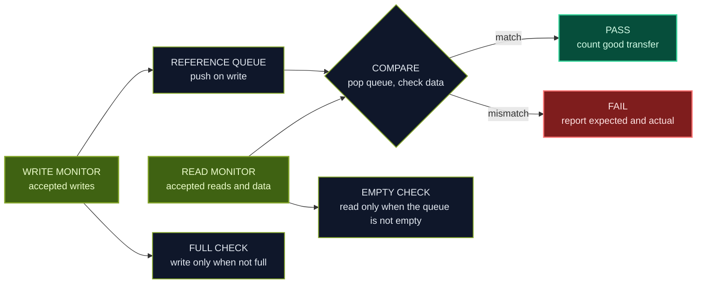
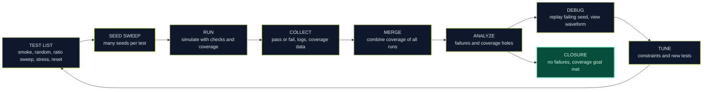
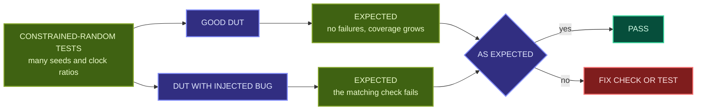

<div align="center">




<b>A UVM-based, coverage-driven verification environment for an asynchronous FIFO and its clock domain crossing logic, using constrained-random stimulus on independent write and read clocks, a reference scoreboard, CDC-specific checks, assertions and cross coverage, written in SystemVerilog.</b>

<br/>


<br/>

[Overview](#overview) |
[At a Glance](#project-at-a-glance) |
[Background](#background-why-cdc-needs-random-verification) |
[Functions](#supported-functions) |
[Architecture](#architecture) |
[Functional Description](#functional-description) |
[Constrained-Random Stimulus](#constrained-random-stimulus) |
[CDC Checks](#cdc-checks-and-scoreboard) |
[Coverage](#cross-coverage) |
[Interface](#interface-and-configuration) |
[Regression Flow](#regression-flow) |
[Getting Started](#getting-started) |
[Verification Plan](#verification-plan) |
[Applications](#applications) |
[FAQ](#faq) |
[License](#license)

</div>

---

## Overview

This project implements a **constrained-random verification environment** for an **asynchronous FIFO with a clock domain crossing (CDC) subsystem**, using **SystemVerilog** and **UVM** (Universal Verification Methodology).

The design under test is a FIFO whose **write side** and **read side** run on **independent clocks**. That is exactly the kind of design where simple directed tests give a false feeling of safety: a handful of hand-written scenarios with fixed clock periods will almost never reach the awkward cases, such as a write and a read pointer updating at nearly the same moment, a fast clock against a slow clock, a long burst that fills the FIFO while the reader is idle, or a reset in the middle of traffic. This environment attacks the problem with **randomization**. It generates **randomized transactions** of **write and read operations** under **controlled constraints**, drives them through a **multi-clock driver** on two independent clock domains, and checks everything that comes out.

The checking has two layers. **FIFO functional checks** make sure the FIFO behaves like a FIFO: data comes out in the order it went in, nothing is lost or duplicated, and the full and empty status is correct. **CDC-specific checks** look at the crossing itself: the Gray coded pointers change by one bit at a time, the pointer transfer between the clock domains is correct, and the synchronizers are used as intended. A **CDC monitor** observes both domains and the pointers, a **scoreboard** with a reference queue compares data, **assertions** watch the rules continuously, and **cross coverage** measures which write and read scenarios, and which clock ratios, have really been exercised.

The environment runs as a **regression**: many tests, many random seeds, one coverage database. The work is finished when no check fails and the coverage goals are reached, which is **verification closure**.

<table>
<tr>
<td width="50%" valign="top">

#### Objectives
- Verify an asynchronous FIFO and its CDC logic with a UVM environment
- Generate constrained-random write and read traffic
- Drive the write and read interfaces on independent, randomized clocks
- Check data integrity, ordering, full and empty status against a reference model
- Check CDC behavior: Gray code pointers, pointer transfer and synchronization
- Measure scenario and clock ratio coverage with cross coverage
- Run seed-based regressions and analyze the results
- Reach verification closure with assertions and coverage together

</td>
<td width="50%" valign="top">

#### Key Features
- Constrained-random verification
- Multi-clock testbench
- FIFO functional checking
- CDC verification
- Cross coverage
- Assertion-based checking
- Randomized scenario generation
- Coverage analysis
- Verification debug
- Regression-oriented testing

</td>
</tr>
</table>

---

## Project at a Glance

| Attribute | Detail |
|:--|:--|
| **Verification type** | Constrained-random, coverage-driven UVM environment |
| **Description language** | SystemVerilog |
| **Methodology** | UVM (Accellera UVM 2017-1.0) |
| **Design under test** | Asynchronous FIFO with CDC subsystem |
| **Clocking** | Independent write clock and read clock, randomized ratio and phase |
| **Stimulus** | Randomized write and read transactions under constraints |
| **Driver** | Multi-clock driver for the write interface and the read interface |
| **Monitoring** | CDC monitor on both domains, observing pointers and data |
| **Functional checks** | Write and read behavior, full and empty status, data integrity |
| **CDC checks** | Synchronization checks, pointer transfer checks, Gray code behavior |
| **Coverage** | Coverpoints and cross coverage of scenarios and clock ratios |
| **Closure** | Assertions, CDC checks, coverage results, debug, re-test |
| **Main output** | Verified FIFO and CDC behavior |
| **Functions** | 10 (stimulus, FIFO checks, CDC checks, multi-clock, coverage, assertions, debug) |
| **Simulation** | Verilator |
| **Waveform analysis** | GTKWave |
| **License** | MIT |

---

## Background: Why CDC Needs Random Verification

#### What the FIFO and the CDC logic do

An asynchronous FIFO carries data between two clock domains that have no fixed relationship. The write side stores data and advances a write pointer. The read side removes data and advances a read pointer. To decide when the FIFO is full or empty, each side needs to know the other side's pointer, so the pointers cross the clock boundary. To cross safely, they are converted to **Gray code**, where only one bit changes between two consecutive values, and they pass through **synchronizers**, which protect the receiving flip-flops against metastability. The flags that result are slightly delayed, which makes them safe but conservative.

#### Why directed tests are not enough

The tricky behavior of such a design appears only for particular timing relationships between the two clocks:

| Situation | Why it is hard to reach by hand |
|:--|:--|
| Fast writer, slow reader | The FIFO fills up and full must stop the writer without overflow |
| Slow writer, fast reader | The FIFO runs empty and empty must stop the reader without underflow |
| Equal frequency, changing phase | Pointer updates land at every possible position relative to the other clock |
| Non-integer ratios | The alignment between the clocks keeps drifting, so no two cycles are the same |
| Pointer wraparound | Many words must pass through to wrap both pointers, in many alignments |
| Reset in the middle of traffic | The two sides come out of reset at different times |
| Bursts and idle gaps | Occupancy swings between empty and full quickly |

A person cannot write enough directed tests to cover all of these. A **constrained-random** environment can: the constraints keep the stimulus legal and focused, and the randomness fills in the combinations that nobody thought of.

#### Constrained-random, coverage-driven verification

| Idea | Meaning |
|:--|:--|
| **Randomization** | Transaction fields and timing are picked randomly each time |
| **Constraints** | Rules that limit the randomness to legal and interesting values |
| **Reference model** | A simple model of the expected behavior, so the checking is automatic for any random stimulus |
| **Functional coverage** | Measures which scenarios the random tests actually produced |
| **Seeds** | Each run starts from a seed. A different seed gives a different but repeatable run |
| **Regression** | Many tests and seeds run together, and their coverage is merged |

Randomization alone does not prove anything. Coverage tells which scenarios were reached, the reference model and the assertions tell whether the design behaved correctly in them. Together they give **verification closure**.

#### What simulation can and cannot show about CDC

Simulation with ideal flip-flops cannot show real metastability. It can show that the **logic** of the crossing is right under many clock relationships: pointers are Gray coded, the flags are conservative, no data is lost. It cannot show that the synchronizers have enough settling time on real silicon, or that every crossing path in a larger design goes through a synchronizer. That part needs structural CDC analysis with dedicated tools. See [Future Work](#future-work).

---

## Supported Functions

| Group | Function | Description |
|:--|:--|:--|
| **Stimulus** | `CONSTRAINED-RANDOM STIMULUS` | Randomized transactions under controlled constraints |
| **Stimulus** | `MULTI-CLOCK VERIFICATION` | Independent write and read clocks with randomized ratio and phase |
| **Checking** | `FIFO READ / WRITE VERIFICATION` | Write and read behavior checked against a reference model |
| **Checking** | `FULL / EMPTY CHECKING` | Full and empty status checked against the expected occupancy |
| **Checking** | `DATA INTEGRITY CHECKING` | Order, loss and duplication of data checked word by word |
| **CDC** | `CDC-SPECIFIC CHECKS` | Checks on the crossing: Gray code behavior and synchronization |
| **CDC** | `POINTER SYNCHRONIZATION CHECKING` | Pointer transfer between the domains checked |
| **Coverage** | `CROSS COVERAGE` | Write and read scenarios crossed with clock configurations |
| **Assertions** | `ASSERTION CHECKS` | Continuous rule checks on both clock domains |
| **Debug** | `SIMULATION-BASED DEBUG` | Failure messages, waveforms and replay by seed |

---

## Architecture

The environment follows the UVM structure. A **test** sets the **test configuration** (verification config, FIFO parameters, clock configuration and reset configuration) and starts **UVM sequences** that create **constrained-random** transactions. A **multi-clock driver** applies them to the DUT through a write interface and a read interface. A **CDC monitor** samples both domains. The monitor output goes to the **FIFO functional checks** (scoreboard), the **CDC-specific checks** and the **cross coverage** collector. **Assertions** run beside the DUT, and the results meet in **assertion and verification closure**.

#### Block diagram

```text
  +----------------------------------------------------------------------------------+
  |                                   UVM TEST                                       |
  |   TEST CONFIGURATION: verification config | FIFO parameters | clock config | reset |
  +------------------------------------+---------------------------------------------+
                                       |
                                       v
                     +------------------------------------+
                     |  UVM SEQUENCE (sequence items)     |
                     |  constrained-random write / read   |
                     +-----------------+------------------+
                                       |
                     +-----------------+------------------+
                     v                                    v
          +--------------------+              +--------------------+
          |   WRITE SEQUENCER  |              |   READ SEQUENCER   |
          +---------+----------+              +----------+---------+
                    v                                    v
          +--------------------+              +--------------------+
          |    WRITE DRIVER    |              |    READ DRIVER     |
          |   (write clock)    |              |    (read clock)    |
          +---------+----------+              +----------+---------+
                    |                                    |
                    v     write interface   read interface v
          +----------------------------------------------------------+
          |         DUT: ASYNCHRONOUS FIFO + CDC SUBSYSTEM           |
          |   write clock domain   <--  CDC  -->   read clock domain |
          +------+----------------------------------------+----------+
                 | observes                               | observes
                 v                                        v
          +----------------------------------------------------------+
          |                     CDC MONITOR                          |
          |   write domain + read domain, pointer and data           |
          |   observation, CDC activity monitoring                   |
          +------+------------------+------------------+-------------+
                 |                  |                  |
                 v                  v                  v
        +----------------+  +----------------+  +----------------+
        | FIFO FUNCTIONAL|  |  CDC-SPECIFIC  |  | CROSS COVERAGE |
        | CHECKS         |  |  CHECKS        |  | coverpoints    |
        | scoreboard     |  |  Gray / sync   |  | clock ratios   |
        +-------+--------+  +--------+-------+  +--------+-------+
                |                    |                   |
                +--------------------+-------------------+
                                     v
                  +------------------------------------------+
                  |  ASSERTIONS + VERIFICATION CLOSURE       |
                  |  coverage results, debug, re-test        |
                  +------------------------------------------+
```

#### Data flow



#### Block breakdown

| # | Block | Role |
|:-:|:--|:--|
| `01` | **FIFO / CDC DUT** | Async FIFO and CDC subsystem with a write clock, a read clock and a data interface |
| `02` | **Test Configuration** | Verification configuration, FIFO parameters, clock configuration and reset configuration |
| `03` | **Constrained-Random Stimulus** | Randomized transactions, write and read operations, controlled constraints |
| `04` | **UVM Sequence** | Generated transactions, sequence items and verification stimulus |
| `05` | **Multi-Clock Driver** | Write transactions to the write interface and read transactions to the read interface, in independent clock domains |
| `06` | **CDC Monitoring** | Write domain and read domain, pointer and data observation, CDC activity monitoring |
| `07` | **FIFO Functional Checks** | Write and read behavior, full and empty status, data integrity checking |
| `08` | **CDC-Specific Checks** | Clock-domain crossing, synchronization checks, pointer transfer checks, CDC behavior analysis |
| `09` | **Cross Coverage** | Write and read scenarios, coverpoints, cross coverage and scenario analysis |
| `10` | **Assertion and Verification Closure** | Assertions and CDC checks, coverage results, debug and re-test |

> **Final block:** a randomized, CDC-aware, coverage-driven verification environment for an asynchronous FIFO

---

## Functional Description

#### FIFO / CDC DUT
The design under verification: an asynchronous FIFO with a write clock domain, a read clock domain and the CDC logic between them. Its write interface takes write data and a write request and reports full. Its read interface takes a read request and returns read data and empty. The DUT is not modified. The environment connects to it through virtual interfaces and a bound checker.

#### Test configuration
A configuration object that the test fills in before the environment starts. It holds the **verification configuration** (which checks and coverage are on, how many transactions to run), the **FIFO parameters** (data width and depth, to match the DUT build), the **clock configuration** (periods, ratio range, phase) and the **reset configuration** (when and how often reset is applied). Components read it from the UVM configuration database, so one environment serves many tests.

#### Constrained-random stimulus
Random generation of write and read transactions with constraints on legal values and on the traffic shape. Constraints decide how long bursts are, how long the gaps between them are, how often reads and writes are enabled, and how clock ratios are chosen. See [Constrained-Random Stimulus](#constrained-random-stimulus).

#### UVM sequence
A sequence creates **sequence items**, each describing one transaction. Sequences can be simple (random writes and reads), or targeted (fill to full, drain to empty, alternate, long streaming). The test chooses which sequence to run on which sequencer, so the same environment can run a quick smoke test or a long random soak.

#### Multi-clock driver
Two drivers, one per clock domain. The write driver is clocked by the write clock and drives the write interface. The read driver is clocked by the read clock and drives the read interface. The two drivers never wait for each other, which is what makes the stimulus truly asynchronous. A clock generator, controlled by the clock configuration, produces the two clocks with randomized period and phase, and can change the ratio between tests.

#### CDC monitoring
Passive monitors on both domains. The write-side monitor samples accepted writes and the write pointer and full flag on the write clock. The read-side monitor samples accepted reads, the returned data, the read pointer and the empty flag on the read clock. It also observes the Gray coded pointers and their synchronized copies, and records CDC activity such as the moment a pointer value reaches the other domain. The monitors only observe. They send transactions out through analysis ports.

#### FIFO functional checks
The scoreboard keeps a reference queue. Every accepted write is pushed into the queue. Every accepted read pops the queue and compares the data. It checks the order and the values of the data, that nothing is lost or duplicated, and that full and empty are consistent with the reference occupancy.

#### CDC-specific checks
Checks that target the crossing itself: the Gray pointers change by one bit at a time, the synchronized pointer is always a value that the source pointer really had, the flags are conservative, and pointer transfer takes the expected number of destination clock cycles. See [CDC Checks and Scoreboard](#cdc-checks-and-scoreboard).

#### Cross coverage
Covergroups sample the scenarios that occurred: which operations, which burst lengths, how full the FIFO was, and which clock ratio and phase were in use. Crosses combine them. See [Cross Coverage](#cross-coverage).

#### Assertion and verification closure
Assertions run continuously beside the DUT, and CDC checks and coverage results are collected. The loop is: run, read the failures and the coverage holes, debug, change constraints or add tests, re-run. See [Regression Flow](#regression-flow).

---

## Constrained-Random Stimulus

#### Transaction (sequence item)

| Field | Meaning | Randomized |
|:--|:--|:-:|
| Operation | Write or read | Yes |
| Data | Write data | Yes |
| Burst length | Number of back-to-back operations | Yes |
| Idle gap | Clock cycles of inactivity before the next operation | Yes |
| Enable pattern | Whether the request is held or toggled | Yes |

#### Randomization and constraints

| Item | Constraint | Purpose |
|:--|:--|:--|
| Clock ratio | Write period to read period within a configured range, including ratios below 1, equal to 1 and above 1 | Cover fast writer, slow writer and equal clocks |
| Clock phase offset | Random fraction of the period | Move pointer updates through every alignment |
| Non-integer ratios | Allow periods with no common divisor | Keep the alignment drifting |
| Burst length | Weighted between single, short and long bursts, long enough to fill the FIFO | Reach full and empty |
| Idle gap | Weighted between zero and long gaps | Create back-to-back and sparse traffic |
| Write enable probability | Weighted from low to high | Control how quickly the FIFO fills |
| Read enable probability | Weighted from low to high | Control how quickly the FIFO drains |
| Write while full | Allowed with a small weight | Check that full blocks the write |
| Read while empty | Allowed with a small weight | Check that empty blocks the read |
| Data | Full range with corner values weighted | Catch data path problems |
| Reset events | Reset in the write domain, the read domain or both, at random times, with random length | Check clean recovery |

The numeric ranges and weights are held in the test configuration and are listed in the configuration table.

#### Clock ratio scenarios

| Scenario | Write clock relative to read clock | Behavior expected |
|:--|:--|:--|
| Write much faster | Several times faster | FIFO fills, full is raised, no overflow |
| Write faster | Slightly faster | FIFO fills slowly |
| Equal | Same period, random phase | Occupancy follows the traffic pattern |
| Read faster | Slightly faster read | FIFO drains slowly |
| Read much faster | Several times faster read | FIFO runs empty, empty is raised, no underflow |
| Non-integer | Periods with no simple ratio | Alignment drifts, data stays correct |
| Ratio change between tests | A new ratio for each test | Every ratio class is reached across the regression |

#### Sequence item skeleton (example)

```systemverilog
class fifo_item extends uvm_sequence_item;
  rand bit          is_write;
  rand bit [7:0]    data;
  rand int unsigned burst_len;
  rand int unsigned idle_gap;

  constraint c_burst { burst_len inside {[1:32]};
                       burst_len dist { 1 := 30, [2:8] := 40, [9:32] := 30 }; }
  constraint c_gap   { idle_gap dist { 0 := 50, [1:4] := 35, [5:20] := 15 }; }
  constraint c_data  { data dist { 8'h00 := 5, 8'hFF := 5, [8'h01:8'hFE] :/ 90 }; }

  `uvm_object_utils_begin(fifo_item)
    `uvm_field_int(is_write,  UVM_ALL_ON)
    `uvm_field_int(data,      UVM_ALL_ON)
    `uvm_field_int(burst_len, UVM_ALL_ON)
    `uvm_field_int(idle_gap,  UVM_ALL_ON)
  `uvm_object_utils_end

  function new(string name = "fifo_item");
    super.new(name);
  endfunction
endclass
```

The field names, widths and weights above are illustrative. The actual values are in `env/fifo_item.sv`.

#### Multi-clock driver skeleton (example)

```systemverilog
class write_driver extends uvm_driver #(fifo_item);
  `uvm_component_utils(write_driver)
  virtual fifo_wr_if vif;   // clocked by the write clock

  task run_phase(uvm_phase phase);
    forever begin
      seq_item_port.get_next_item(req);
      repeat (req.idle_gap) @(posedge vif.wclk);
      repeat (req.burst_len) begin
        @(posedge vif.wclk);
        vif.winc  <= 1'b1;
        vif.wdata <= req.data;
      end
      @(posedge vif.wclk);
      vif.winc <= 1'b0;
      seq_item_port.item_done();
    end
  endtask
endclass
```

The read driver has the same structure and is clocked by the read clock. The two drivers run in parallel and never share a clock event.

---

## CDC Checks and Scoreboard

#### Scoreboard with a reference queue



| Check | What it verifies |
|:--|:--|
| Data value | Each read returns the data of the oldest unread write |
| Order | Data comes out in the same order as it went in |
| No loss | The number of reads that complete equals the number of writes that were accepted, once the FIFO is drained |
| No duplication | A word is never returned twice |
| Full status | The full flag is never raised when the reference queue has room, beyond the allowed flag delay |
| Empty status | The empty flag is never raised when the reference queue holds data, beyond the allowed flag delay |
| No overflow | A write is never accepted when the FIFO is really full |
| No underflow | A read is never accepted when the FIFO is really empty |
| End of test | The reference queue is empty and all data has been read |

#### CDC-specific checks

| Check | Rule |
|:--|:--|
| Gray code step | The write and read Gray pointers change by at most one bit per clock cycle |
| Gray to binary match | A Gray pointer always equals the Gray code of its binary pointer |
| Synchronized pointer validity | A synchronized pointer is always a value that the source pointer has held |
| Synchronizer delay | A pointer change reaches the other domain within the allowed number of destination clock cycles |
| Conservative flags | Full and empty never report more free space or more data than really exists |
| Flag clears | Full clears and empty clears after the pointer has crossed, not before |
| Pointer wrap | Wrap bit toggles exactly when a pointer wraps around the memory |
| Reset recovery | After reset in either domain, both sides return to a consistent empty state |

#### Gray pointer assertion (example)

```systemverilog
// The Gray coded write pointer may change by at most one bit per write clock cycle
property p_wptr_gray_onebit;
  @(posedge wclk) disable iff (!wrst_n)
    $countones(wptr_gray ^ $past(wptr_gray)) <= 1;
endproperty
a_wptr_gray_onebit: assert property (p_wptr_gray_onebit)
  else $error("write Gray pointer changed by more than one bit");

// Prove that the property is exercised
c_wptr_moves: cover property (@(posedge wclk) disable iff (!wrst_n)
                              wptr_gray != $past(wptr_gray));
```

The signal names are illustrative. The checker is attached to the DUT with `bind`, so the DUT source is unchanged.

#### Assertions

| Property | What it checks |
|:--|:--|
| Gray one-bit step (write) | Write Gray pointer changes by at most one bit per cycle |
| Gray one-bit step (read) | Read Gray pointer changes by at most one bit per cycle |
| No overflow | A write is not accepted while full is raised |
| No underflow | A read is not accepted while empty is raised |
| Flag exclusivity | Full and empty are never raised at the same time |
| Reset state | After reset the FIFO is empty and not full |
| Pointer range | The memory address is always inside the memory array |
| Cover of each assertion | Each assertion has a matching cover that must be hit at least once |

---

## Cross Coverage

#### What is measured

| Coverpoint | Bins |
|:--|:--|
| Operation | Write, read |
| Burst length | Single, short, long |
| Idle gap | None, short, long |
| FIFO occupancy | Empty, low, middle, high, full |
| Clock ratio class | Write much faster, write faster, equal, read faster, read much faster, non-integer |
| Clock phase offset | Several phase bins |
| Flag events | Full raised, full cleared, empty raised, empty cleared |
| Pointer wrap | Write pointer wrapped, read pointer wrapped, both wrapped |
| Reset event | Write reset, read reset, both, during traffic |
| Simultaneous access | Write and read in the same alignment window |

#### Crosses

| Cross | Why it matters |
|:--|:--|
| Operation x burst length | Every kind of operation with every burst size |
| Clock ratio class x FIFO occupancy | Full and empty reached at every clock ratio |
| Clock ratio class x flag events | Every flag transition seen at every ratio |
| Clock ratio class x phase offset | Every alignment at every ratio |
| Pointer wrap x clock ratio class | Wraparound at every ratio |
| Reset event x FIFO occupancy | Reset at every fill level |
| Burst length x idle gap | Dense and sparse traffic shapes |

#### Covergroup skeleton (example)

```systemverilog
covergroup cg_fifo_scenarios with function sample(
    bit is_write, int unsigned burst_len, int unsigned occ_pct,
    int unsigned ratio_class);

  cp_op    : coverpoint is_write { bins write = {1}; bins read = {0}; }
  cp_burst : coverpoint burst_len {
    bins single = {1};
    bins short_b = {[2:8]};
    bins long_b  = {[9:32]};
  }
  cp_occ   : coverpoint occ_pct {
    bins empty  = {0};
    bins low    = {[1:33]};
    bins middle = {[34:66]};
    bins high   = {[67:99]};
    bins full   = {100};
  }
  cp_ratio : coverpoint ratio_class {
    bins wr_much_faster = {0};
    bins wr_faster      = {1};
    bins equal          = {2};
    bins rd_faster      = {3};
    bins rd_much_faster = {4};
    bins non_integer    = {5};
  }

  x_ratio_occ : cross cp_ratio, cp_occ;
  x_op_burst  : cross cp_op, cp_burst;
endgroup
```

The bins and class numbers are illustrative.

#### Scenario analysis

After a regression the coverage report shows which bins and crosses were not hit. Each hole is handled in one of three ways:

| Hole | Action |
|:--|:--|
| Scenario is possible but not reached | Change the constraints or add a directed sequence that targets it |
| Scenario is impossible in this DUT | Exclude it with an ignore bin and a written reason |
| Scenario must never happen | Make it an illegal bin and check that it is never hit |

#### Coverage metrics

| Metric | Meaning |
|:--|:--|
| Bin coverage | Bins hit divided by bins defined |
| Cross coverage | Combinations hit divided by combinations defined |
| Assertion cover count | How often each assertion was exercised |
| Merged coverage | Coverage merged across all tests and seeds of a regression |

---

## Interface and Configuration

#### DUT interface signals

| Signal | Domain | Direction (DUT) | Description |
|:--|:-:|:-:|:--|
| Write clock | Write | Input | Clock of the write side |
| Write reset | Write | Input | Reset of the write side |
| Write enable (request) | Write | Input | Request to write the data |
| Write data | Write | Input | Data to be stored |
| Full | Write | Output | FIFO cannot accept more data |
| Read clock | Read | Input | Clock of the read side |
| Read reset | Read | Input | Reset of the read side |
| Read enable (request) | Read | Input | Request to read the oldest data |
| Read data | Read | Output | Data read from the FIFO |
| Empty | Read | Output | FIFO has no data to read |

Exact names, widths and polarities come from the DUT sources.

#### Signals observed by the CDC monitor

| Signal | Observed in | Use |
|:--|:-:|:--|
| Write pointer (binary and Gray) | Write domain | Gray code checks, occupancy |
| Read pointer (binary and Gray) | Read domain | Gray code checks, occupancy |
| Synchronized write pointer | Read domain | Pointer transfer and empty checks |
| Synchronized read pointer | Write domain | Pointer transfer and full checks |

These are internal signals and are reached through `bind` or hierarchical references from the checker.

#### Verification parameters and configuration

| Item | Value |
|:--|:-:|
| FIFO data width | `TBD` |
| FIFO depth | `TBD` |
| Synchronizer stages | `TBD` |
| Write clock period range | `TBD` |
| Read clock period range | `TBD` |
| Phase offset range | `TBD` |
| Burst length and idle gap weights | `TBD` |
| Write and read enable probabilities | `TBD` |
| Reset events per test | `TBD` |
| Transactions per test | `TBD` |
| Allowed flag delay in destination clock cycles | `TBD` |
| Number of seeds per test in the regression | `TBD` |
| Coverage goal | `TBD` |

---

## Regression Flow

The environment is run as a regression: a list of tests, each run with many random seeds. The same test with a different seed produces different traffic and different clock alignments, and a failing seed can be replayed exactly to debug it.



#### Test list

| Test | Purpose |
|:--|:--|
| `smoke_test` | Short run with a fixed ratio, to check that the environment and DUT work |
| `random_test` | General constrained-random traffic with random clock ratio and phase |
| `ratio_sweep_test` | Steps through every clock ratio class |
| `fill_drain_test` | Fills the FIFO to full, then drains it to empty, repeatedly |
| `stress_test` | Long random run with high enable probability and many wraparounds |
| `slow_reader_test` | Fast writer and slow reader, to reach full |
| `slow_writer_test` | Slow writer and fast reader, to reach empty |
| `reset_test` | Reset in either or both domains during traffic |
| `corner_data_test` | Corner data values with random timing |

#### Seed-based regression

1. Pick the test list and the number of seeds per test.
2. Run each test with every seed. Each run writes its log and its coverage data.
3. A run passes only if no assertion fails, the scoreboard reports no mismatch and the reference queue is empty at the end.
4. Merge the coverage data of all passing runs.
5. Read the failures and the coverage holes, then debug or tune.
6. Repeat until there are no failures and the coverage goal is met.

#### Replaying a failure

Every run prints its seed. A failing run is repeated with the same test name and the same seed, which reproduces the same traffic and the same clock alignment, and the waveform can then be opened at the time of the first failure.

---

## Repository Structure

```text
constrained-random-fifo-cdc-verification/
├── rtl/
│   └── async_fifo/                 # DUT: asynchronous FIFO and CDC subsystem
├── env/
│   ├── fifo_item.sv                # Sequence item with constraints
│   ├── fifo_sequences.sv           # Random and directed sequences
│   ├── fifo_config.sv              # Test configuration object
│   ├── clock_gen.sv                # Randomized write and read clock generator
│   ├── write_driver.sv             # Write-domain driver
│   ├── read_driver.sv              # Read-domain driver
│   ├── write_monitor.sv            # Write-domain monitor
│   ├── read_monitor.sv             # Read-domain monitor
│   ├── cdc_monitor.sv              # Pointer and CDC activity monitor
│   ├── fifo_scoreboard.sv          # Reference queue scoreboard
│   ├── cdc_checker.sv              # CDC-specific checks and assertions
│   ├── fifo_coverage.sv            # Covergroups and cross coverage
│   ├── fifo_env.sv                 # UVM environment
│   └── fifo_pkg.sv                 # Package with all UVM classes
├── tests/
│   └── fifo_tests.sv               # UVM tests
├── tb/
│   ├── fifo_if.sv                  # Write and read interfaces
│   ├── bind_checkers.sv            # Bind of the checkers to the DUT
│   └── tb_top.sv                   # Top-level testbench
├── scripts/
│   └── run_regression.sh          # Seed sweep and coverage merge
├── sim/
│   ├── waves.vcd                   # Generated waveform dump
│   └── coverage_report/            # Merged coverage report
├── docs/
│   └── verification_plan.md        # Plan, checks and coverage goals
├── LICENSE
└── README.md
```

---

## Technology Stack

| Tool | Role in this project |
|:--|:--|
|  | Testbench, constraints, assertions and covergroups |
|  | Verification methodology: sequences, drivers, monitors, scoreboard, configuration |
|  | Compiles and simulates the testbench and the DUT |
|  | Views waveforms of both clock domains |

---

## Getting Started

UVM support in Verilator is recent. Upstream UVM 2017-1.0 started to elaborate without patches in late 2025, and functional covergroups arrived in Verilator release 5.050. Some UVM or coverage constructs may still be unsupported in the version you use. The environment is written in standard UVM and SystemVerilog, so the same code can also be run on commercial UVM simulators.

#### Prerequisites

| Tool | Purpose | Version |
|:--|:--|:--|
| Verilator | Simulation, assertions and coverage | Latest from the GitHub repository (5.050 or later) |
| Accellera UVM | UVM library | 1800.2-2017-1.0 |
| GTKWave | Waveform viewer | Any recent |

#### 1. Build Verilator from source

```bash
sudo apt update
sudo apt install git autoconf flex bison help2man libfl-dev libfl2 zlib1g-dev perl python3 make g++ gtkwave

git clone https://github.com/verilator/verilator.git
cd verilator
autoconf
./configure
make -j $(nproc)
sudo make install
verilator --version
cd ..
```

#### 2. Get the UVM library

Download the Accellera UVM 1800.2-2017-1.0 package from the Accellera website, extract it, and point `UVM_HOME` at its `src` directory.

```bash
export UVM_HOME=/path/to/Accellera-1800.2-2017-1.0/src
```

#### 3. Clone this repository

```bash
git clone https://github.com/dhruvalmistry2007/constrained-random-fifo-cdc-verification.git
cd constrained-random-fifo-cdc-verification
```

#### 4. Compile

```bash
verilator -Wno-fatal --binary --timing --trace --assert --coverage -j $(nproc) \
  --top-module tb_top \
  +incdir+$UVM_HOME +define+UVM_NO_DPI +incdir+env +incdir+tests +incdir+tb \
  $UVM_HOME/uvm_pkg.sv \
  rtl/async_fifo/*.sv \
  tb/fifo_if.sv env/fifo_pkg.sv tests/fifo_tests.sv tb/bind_checkers.sv tb/tb_top.sv
```

`--timing` is needed for the clock generator and the drivers, `--assert` turns on the assertions and `--coverage` turns on coverage collection. `UVM_NO_DPI` removes the parts of UVM that need the C library.

#### 5. Run a test with a seed

```bash
./obj_dir/Vtb_top +UVM_TESTNAME=random_test +verilator+seed+1 +verilator+rand+reset+2
```

`+UVM_TESTNAME` picks the test, and `+verilator+seed+<n>` sets the random seed. Run again with a different number to get different traffic.

#### 6. Run the regression

```bash
bash scripts/run_regression.sh
```

The script loops over the test list and the seeds, collects the logs and merges the coverage data.

#### 7. Read the coverage and view waveforms

```bash
verilator_coverage --annotate sim/coverage_report sim/coverage_merged.dat
gtkwave sim/waves.vcd
```

The testbench also prints the coverage of each covergroup at the end of a run. Use the failure time printed in a message to jump to the failing cycle in the waveform.

---

## Verification Plan

The environment is itself verified, because a checker that never fails proves nothing. Every check is tried on a correct design and on a design with a deliberate bug.



#### Test plan

| Area | Scenario | Expected behavior |
|:--|:--|:--|
| Clean run | Run the full test list on the unmodified DUT | No assertion fails and the scoreboard reports no mismatch |
| Environment check | Smoke test with a fixed ratio | Environment builds, runs and ends cleanly |
| Data integrity | Random traffic across all clock ratios | Every word read equals the word written, in order |
| Fast writer | Write clock much faster than read clock | FIFO reaches full and blocks writes, with no overflow |
| Fast reader | Read clock much faster than write clock | FIFO reaches empty and blocks reads, with no underflow |
| Equal clocks | Same period, many phase offsets | Data is correct at every alignment |
| Non-integer ratio | Clock periods with no common divisor | Data is correct as the alignment drifts |
| Fill and drain | Fill to full, drain to empty, repeat | Flags rise and clear at the correct boundaries |
| Wraparound | Pass many times the FIFO depth through it | Pointers wrap and data stays correct |
| Reset | Reset one or both domains during traffic | Both sides return to a consistent empty state |
| Gray code | Observe the pointers on every random run | One bit changes per step in every cycle |
| Pointer transfer | Compare synchronized and source pointers | Synchronized value is always a past source value, within the allowed delay |
| Conservative flags | Compare flags with the reference occupancy | Flags are never optimistic |
| Bug injection, data | Corrupt data or reorder words in the DUT | Scoreboard fails |
| Bug injection, overflow | Let the DUT accept a write when full | Overflow check fails |
| Bug injection, underflow | Let the DUT accept a read when empty | Underflow check fails |
| Bug injection, Gray | Replace a Gray pointer with a binary pointer in the crossing | Gray one-bit assertion fails |
| Bug injection, flag | Make the full flag optimistic | Flag consistency check fails |
| Bug injection, synchronizer | Bypass a synchronizer in the model | Pointer transfer check fails |
| Coverage | Merge all runs of the regression | Coverage goal is reached or holes are explained |
| Replay | Re-run a seed | Same behavior, same result |

#### Coverage matrix

| Area | Functions checked | Result |
|:--|:--|:-:|
| Stimulus | Constrained-random stimulus, multi-clock verification | `TBD` |
| FIFO checks | Read / write verification, full / empty checking, data integrity | `TBD` |
| CDC checks | CDC-specific checks, pointer synchronization checking | `TBD` |
| Assertions | Assertion checks | `TBD` |
| Coverage | Cross coverage | `TBD` |
| Debug | Simulation-based debug and replay | `TBD` |

#### Results

| Metric | Value |
|:--|:-:|
| Tests in the list | `TBD` |
| Seeds per test | `TBD` |
| Total runs | `TBD` |
| Passing runs | `TBD` |
| Injected bugs caught | `TBD` |
| Assertions defined | `TBD` |
| Assertions with cover count above zero | `TBD` |
| Covergroup coverage (merged) | `TBD` |
| Cross coverage (merged) | `TBD` |
| Open coverage holes with reason | `TBD` |

#### Waveform analysis checklist

| Signal | What to confirm |
|:--|:--|
| Write clock and read clock | Different periods and phases, as set by the test |
| Write enable and write data | Accepted only when the FIFO is not full |
| Write pointer (binary and Gray) | Advances per accepted write, one Gray bit per step |
| Read enable and read data | Data returned in write order |
| Read pointer (binary and Gray) | Advances per accepted read, one Gray bit per step |
| Synchronized pointers | Follow the source pointer after the synchronizer delay |
| Full and empty | Switch at the boundaries and are never optimistic |
| Reset in each domain | Both sides recover to a consistent state |
| Assertion failure time | The waveform at that time shows the cause |

---

## Synthesis Considerations

The UVM environment, the constraints, the covergroups and the assertions are **verification code**. They are not synthesized. Only the DUT, the asynchronous FIFO and its CDC logic, is a synthesis target.

| Aspect | Approach |
|:--|:--|
| **Separation** | DUT sources, environment, tests and checkers are in separate folders |
| **Synthesis input** | Only the files under `rtl/` go to a synthesis tool |
| **Checkers** | CDC checks and assertions are attached with `bind`, so the DUT source stays unchanged |
| **Simulation only** | UVM classes, randomization, covergroups and the clock generator are simulation constructs |

---

## Design Considerations

| Aspect | Approach |
|:--|:--|
| **Independence of the clocks** | Write and read drivers run in separate clock domains and never wait for each other |
| **Randomness with control** | Constraints keep the stimulus legal and weight it toward corner cases |
| **Repeatability** | Every run prints its seed, so a failure can be replayed exactly |
| **Self-checking** | A reference queue and assertions judge the result, so no output is checked by hand |
| **Non-intrusive checking** | Monitors and checkers only observe and never drive the DUT |
| **Conservative flags** | Checks allow the flag delay of the synchronizers and reject optimistic flags |
| **Coverage-driven** | Cross coverage, not the number of tests, decides when the work is done |
| **Reuse** | One environment serves many tests through the configuration object |
| **Checker quality** | Bug injection confirms that every check can fail |
| **Simulator portability** | Standard UVM and SystemVerilog, usable on Verilator and on commercial simulators |

#### Current limitations
- Simulation cannot show real metastability, and ideal flip-flops always resolve
- Structural CDC analysis is not part of this environment
- UVM and covergroup support in Verilator is recent and some constructs may be unsupported
- Coverage goals are only as complete as the plan they come from
- No formal verification of the FIFO and CDC properties

---

## Applications

- Verifying asynchronous FIFOs and other clock domain crossing blocks
- Template for constrained-random UVM environments with several clock domains
- Reference for writing CDC-aware scoreboards, monitors and assertions
- Regression and coverage closure practice with seed sweeps
- Starting point for verifying handshake and pulse synchronizers
- Teaching design for constrained-random, coverage-driven verification

---

## Customization

#### Add a new constraint or traffic pattern

1. Add the new field or constraint to the sequence item.
2. Write a sequence that uses it, or extend an existing sequence.
3. Add a test that starts the sequence.
4. Add coverage bins for the new behavior.
5. Run the regression and check that the new bins are hit.

#### Change the clock ratio range or the phase range

1. Change the clock configuration in the test configuration object.
2. Re-check the ratio class bins in the coverage so that every class stays reachable.
3. Re-run the ratio sweep test and the regression.

#### Verify a different DUT configuration

1. Set the FIFO data width, depth and synchronizer stages in the configuration.
2. Rebuild the DUT with the same parameters.
3. Update the allowed flag delay in the CDC checks.
4. Re-run the full test list, then the bug injection tests.

#### Add a new CDC check

1. Write the rule in words, with a name.
2. Implement it as an assertion or a scoreboard check.
3. Add a `cover property` for the condition that triggers it.
4. Add a bug injection that makes it fail.
5. Add it to the verification plan.

---

## Troubleshooting

| Problem | Likely cause | Fix |
|:--|:--|:--|
| `--binary` option not recognized | Verilator version is older than 5.x | Install the latest Verilator from source |
| UVM package does not compile | Verilator is too old for UVM, or `UVM_NO_DPI` is missing | Use the latest Verilator and add `+define+UVM_NO_DPI` |
| UVM cannot be found | `UVM_HOME` is not set or points to the wrong folder | Point `UVM_HOME` at the `src` directory of UVM 2017-1.0 |
| A covergroup construct is rejected | The construct is not yet supported in this Verilator version | Upgrade Verilator or use a simpler bin form |
| Delays in the testbench are rejected | Timing support is not enabled | Build with `--timing` |
| Assertions never fire | Assertions are not enabled | Build with `--assert` |
| Coverage report is empty | Coverage is not enabled, or the run did not finish | Build with `--coverage` and let the test end normally |
| Same result for every seed | Seed option is not used by the run | Pass `+verilator+seed+<n>` and check that the test uses randomization |
| Test never ends | An objection is never dropped | Check that every sequence drops its objection when done |
| Scoreboard mismatch only at some ratios | Allowed flag delay is too small | Check the synchronizer depth against the allowed delay |
| False full or empty failures | Check does not allow for the synchronizer delay | Compare flags with the reference only after the allowed delay |
| Failure right after reset | Check is active during reset | Add `disable iff` and wait until reset is released in both domains |
| `waves.vcd` is not generated | Tracing is not enabled | Build with `--trace` and make sure the testbench calls `$dumpfile` and `$dumpvars` |
| Bind does not find the pointers | Names in the bind do not match the DUT | Use the exact internal signal names of the DUT |

---

## FAQ

**Why is constrained-random verification a good fit for an asynchronous FIFO?**
The difficult cases depend on the timing between two clocks. Random clock ratios, phases and traffic shapes reach many more alignments than a person can write by hand, and the reference model checks every one of them automatically.

**What do the constraints do?**
They keep the random values legal and steer the randomness toward useful cases. Without constraints most of the stimulus would be meaningless, and without randomness the interesting corner cases would be missed.

**Why two drivers instead of one?**
The write side and the read side have independent clocks. A single driver cannot act on two unrelated clocks without tying them together, which would hide exactly the problems the test is looking for.

**Why does the scoreboard allow a flag delay?**
The flags are built from pointers that have crossed the clock boundary, so they update a few destination clock cycles late. This is by design and keeps the FIFO safe. The check accepts that delay but rejects any flag that is optimistic.

**What is checked by the CDC-specific checks that the FIFO checks do not cover?**
The FIFO checks only look at the data and the flags. The CDC checks look at the mechanism: Gray code behavior, the validity of synchronized pointers and the timing of the transfer. They find problems that would otherwise appear only rarely in the data.

**Why use seeds?**
A seed makes a random run repeatable. A failure found with seed 42 can be repeated exactly with seed 42 for debugging, and many seeds give many different runs of the same test.

**Does this prove that the CDC design is safe?**
No. It shows that the logic behaves correctly across many clock relationships. It cannot show metastability behavior or find missing synchronizers in a larger design, which needs structural CDC analysis tools and timing analysis.

**Why Verilator and GTKWave?**
They are free and open source, so the whole environment can be reproduced without licenses. The code is standard UVM and SystemVerilog and can also be run on commercial simulators.

---

## Learning Outcomes

- Building a UVM environment with sequences, drivers, monitors and a scoreboard
- Writing constrained-random stimulus with weighted constraints
- Driving two independent clock domains from separate drivers
- Writing a reference-queue scoreboard
- Checking Gray code pointers and synchronized pointers
- Writing assertions with `disable iff` and matching covers
- Defining coverpoints and cross coverage for clock ratios and scenarios
- Running seed-based regressions and merging coverage
- Debugging by replaying a failing seed and reading waveforms
- Verifying the checks with bug injection

---

## Design Flow


<div align="center">

`CONSTRAINED-RANDOM` | `FIFO STIMULUS` | `MULTI-CLOCK DUT` | `CDC MONITORING` | `FUNCTIONAL CHECKS` | `CROSS COVERAGE` | `ASSERTIONS` | `VERIFY`

</div>

---

## Future Work

- Run structural CDC analysis with a dedicated CDC tool to check every crossing path
- Add formal verification of the Gray pointer and flag properties
- Add static timing constraints and analysis for the synchronizer paths
- Add handshake and pulse synchronizer verification environments
- Add a coverage-driven test generator that targets open holes
- Add a regression dashboard with pass rate and merged coverage trends
- Add UVM register-based configuration of the clocks and the DUT
- Extend the environment to several writers and several readers
- Run the environment on a commercial UVM simulator for comparison

---

## Contributing

Suggestions and improvements are welcome. Open an issue to discuss a change, or submit a pull request with a clear description of what it does and the simulation results that support it.

---

## References

- [Verilator](https://www.veripool.org/verilator/): open-source SystemVerilog simulator
- [GTKWave](https://gtkwave.sourceforge.net/): waveform viewer
- [Accellera UVM](https://www.accellera.org/downloads/standards/uvm): Universal Verification Methodology library
- IEEE Std 1800: SystemVerilog language standard
- IEEE Std 1800.2: UVM standard
- Clifford E. Cummings, "Simulation and Synthesis Techniques for Asynchronous FIFO Design", SNUG San Jose 2002

---

## License

This project is licensed under the **MIT License**. See the [LICENSE](LICENSE) file for details.

---

## Author

<div align="center">

**Dhruval Mistry**

[](https://github.com/dhruvalmistry2007)

<br/>


</div>
